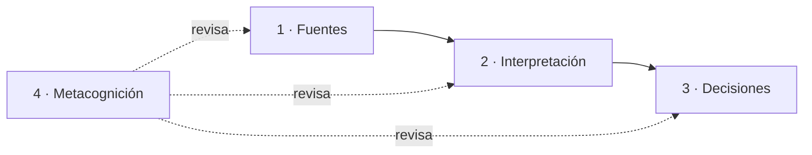

# Studyhub · Inicio

> **En una frase:** plataforma web que ayuda a universitarios a saber, *antes de comprometerse*, si alguien estudia como ellos, y que también sirve a quienes prefieren estudiar solos.

## Cómo está organizado este vault

El conocimiento está en **capas**. Cada capa se apoya en la anterior. Si una idea no se puede rastrear hasta una fuente, es un supuesto, no un hallazgo.

| Capa | Pregunta que responde | Dónde |
|---|---|---|
| **0 · Orientación** | ¿Dónde estoy y qué hay acá? | esta nota, [[CLAUDE]] |
| **1 · Fuentes** | ¿Qué dicen los datos, tal cual? | `Notas/1 Fuentes` |
| **2 · Interpretación** | ¿Qué entiendo a partir de los datos? | `Notas/2 Interpretacion` |
| **3 · Decisiones** | ¿Qué diseñé y por qué? | `Notas/3 Decisiones` |
| **4 · Metacognición** | ¿Cómo pensé, qué asumí y qué me falta? | `Notas/4 Metacognicion` · `Notas/Bitacora` |
| **5 · Estrategia** | ¿Hacia dónde mejorar y quién se encarga? | [[Matriz de posibilidades]] · [[Sistema de agentes]] · [[Indice del proyecto]] |
| **6 · Mejoras** | ¿Qué proponen los agentes de pilar? | `Notas/6 Mejoras` |
| **7 · Auditoría** | ¿El proceso es correcto y honesto? | `Notas/7 Auditoria` |

## Recorrido sugerido

1. **Fuentes:** [[Brief del cliente]] → [[Entrevistas]] → [[Benchmark]] → [[Conversacion con ChatGPT]]
2. **Interpretación:** [[Hallazgos]] → [[Insights]] → [[Las 3 capas de compatibilidad]] → [[Persona - Sofia]] / [[Persona - Mateo]] → [[Oportunidades de diseno]] → [[Problema y propuesta de valor]]
3. **Decisiones:** [[Diseno de la plataforma]] → [[Heuristicas de Nielsen aplicadas]] → [[Componentes de la interfaz]] → [[Registro de decisiones]]
4. **Metacognición:** [[Supuestos vs evidencia]] → [[Limites y sesgos]] → [[Preguntas abiertas]] → [[Reflexion del proceso]]

## Estado actual

- ✅ Investigación, personas, oportunidades y definición del problema.
- ✅ Crazy 8, Bocetos 2.0, User Flow y demo interactiva publicada.
- ⚠️ La evidencia tiene huecos: ver [[Limites y sesgos]] y [[Preguntas abiertas]].
- ⏭️ Próximo paso natural: test de usabilidad de la demo con estudiantes reales.
- 🤖 Mejora continua: `/ciclo-de-mejora` (ver [[Sistema de agentes]]).

## Archivos originales (sin mover)

- [[00 Resumen del proyecto.pdf]]: todo el proceso en un documento
- `01 Material de origen`: brief, guía, entrevistas, referencia y bocetos a mano
- `02 Investigacion`: bitácora en PowerPoint
- `03 Crazy 8` · `04 Bocetos 2.0` · `05 User Flow` · `06 Demo de la plataforma`
- [[README]] (versión para GitHub) · [[Links del proyecto.txt]]
