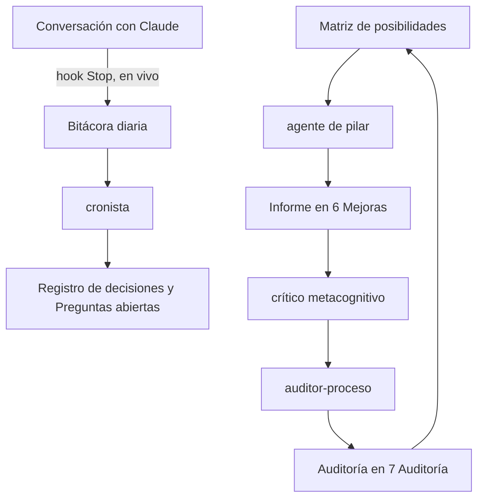

# Sistema de agentes

El conocimiento crece en capas, y cada capa tiene a alguien que la cuida. Los agentes viven en `.claude/agents/` y se usan desde Claude Code abierto en esta carpeta.

## Los agentes

| Capa | Agente | Qué hace |
|---|---|---|
| **Registro en vivo** | *hook* `anexar_bitacora.py` | Cada vez que Claude termina de responder, anexa tu pedido, la respuesta y los archivos tocados a `Notas/Bitacora/AAAA-MM-DD.md`. |
| **Síntesis** | `cronista` | Convierte la bitácora en decisiones, preguntas abiertas y un resumen del día. |
| **Mejora (pilares)** | `pilar-evidencia` (P1) · `pilar-compatibilidad` (P2, P8) · `pilar-usabilidad` (P3) · `pilar-confianza` (P4) · `pilar-sesion` (P5) · `pilar-solo` (P6) · `pilar-retencion` (P7) | Cada uno trabaja su fila de la [[Matriz de posibilidades]] con 4 capas: observar → interpretar → proponer → metacognición. |
| **Metacognición** | `critico-metacognitivo` | Cuestiona los informes: busca sesgos, saltos lógicos y alternativas. |
| **Auditoría** | `auditor-proceso` | Verifica trazabilidad, honestidad de la evidencia, coherencia entre documentos y que nadie haya tocado los originales. |

## Cómo usarlo
- **Ciclo completo:** escribe `/ciclo-de-mejora` (o `/ciclo-de-mejora P4` para un pilar concreto).
- **Un agente suelto:** "usa el agente `auditor-proceso`" o "pídele a `pilar-usabilidad` que revise la demo".
- **Fin del día:** "que el `cronista` resuma la bitácora de hoy".

## Reglas comunes
- Ningún agente modifica los originales (`00`–`06`, README o la demo) sin tu aprobación.
- Ningún agente inventa datos de usuarios.
- Toda afirmación enlaza su fuente.
